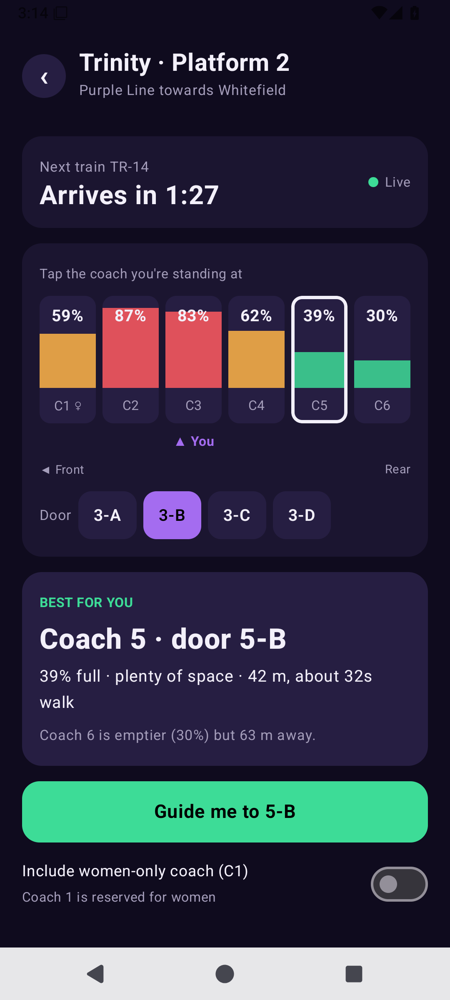
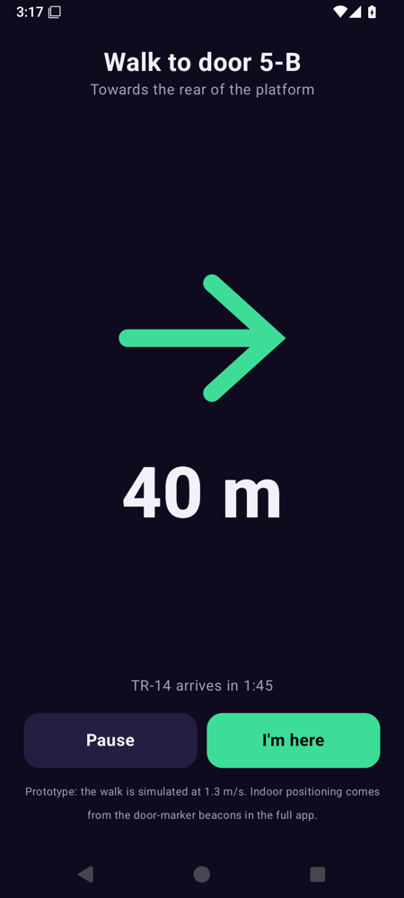
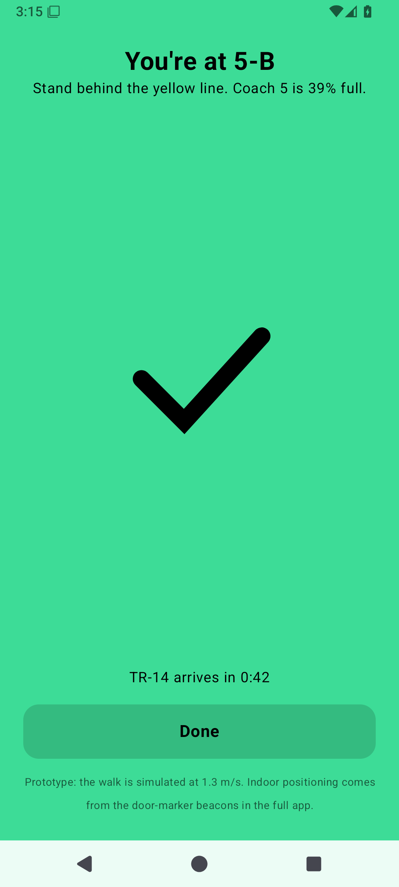
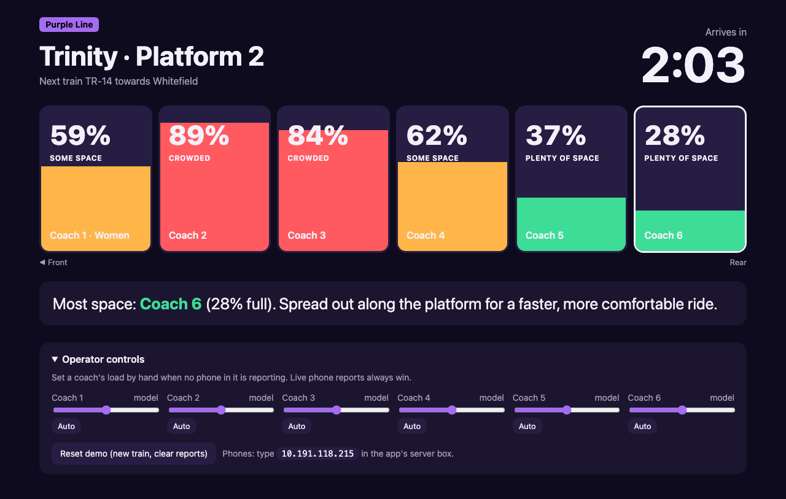

# CoachCompass prototype

**Find the empty Namma Metro coach before the train arrives.** iQOO Hackathon, Bengaluru · Track 07 Mobility.

**Download the app:** grab `CoachCompass-Prototype.apk` from the [latest release](../../releases/latest).

| Platform view | Guide me | Arrived | Station board |
| --- | --- | --- | --- |
|  |  |  |  |

A working Android app plus a tiny laptop server. Real Bluetooth counting on the train, live coach loads on the platform, a "Guide me" walk to the best door, and red/green door lights.

## Files

| Path | What it is |
| --- | --- |
| `CoachCompass-Prototype.apk` (Releases) | Install on the iQOO phones (Android 12+) |
| `Start-Server.command` | Double-click on the Mac: starts the server and opens the station board |
| `server/` | `server.js` (no dependencies, Node 18+) and `board.html` (station display + operator sliders) |
| `android/` | Kotlin + Jetpack Compose source. Build: `cd android && ./gradlew assembleDebug` (needs JDK 17–21; `gradle.properties` pins a Homebrew JDK 21 path, so delete the `org.gradle.java.home` line on other machines) |

## Run it

**One phone, no laptop:** install the APK and open it. It runs in Demo mode with a simulated TR-14. The "On the train" sensor feeds this phone's own platform view.

**Several phones (the real demo):**
1. Put the laptop and phones on the same Wi-Fi or phone hotspot.
2. Double-click `Start-Server.command`. The Terminal window prints the laptop IP.
3. In the app on each phone, type that IP in the server box and tap Save. The dot turns green ("Live").
4. Give each phone a role:
   - **On the train** (1–2 phones): pick the coach number, tap Start sensing. Raise "Demo scale" if the hall is quiet. The board shows that coach as LIVE.
   - **On the platform** (1 phone, the "Ananya" phone): tap the coach you're standing at, see the best door, tap Guide me. Two buzzes on arrival.
   - **Door light** (rest of the phones): pick a coach, Start door light. Full-screen green / amber / red. Line them up in coach order.
5. Show the station board on the laptop/projector. Use the operator sliders to make a coach full and watch the door lights and the recommendation change.

## Install the APK

Easiest: send the APK to the phone (USB, Drive, WhatsApp to yourself), open it and allow "Install unknown apps". Or with USB debugging on: `adb install -r CoachCompass-Prototype.apk`.

## What's real and what's simulated

| Part | Status |
| --- | --- |
| Bluetooth LE device count, people and load estimate (0.85 devices/person, 330 people = 100%) | Real, on-device |
| Upload one anonymous number per coach, merge on the server, push to platform phones (1 s polling) | Real, over local Wi-Fi |
| Best-coach pick (load + 0.6 × metres walked, unreachable coaches last) | Real |
| Door lights mirroring live loads | Real |
| Coach check-in | Tap a number (QR scan is planned) |
| Train arrival time | Simulated 150 s cycle (no real Namma Metro feed) |
| Walking guidance | Simulated at 1.3 m/s (door-marker beacons planned) |
| Coaches without a reporting phone | Demo story loads 58/88/84/63/38/29% with a small drift, or the operator slider |

## Credits

Built with open-source Android Jetpack Compose and Node.js. AI coding assistants were used during development.
